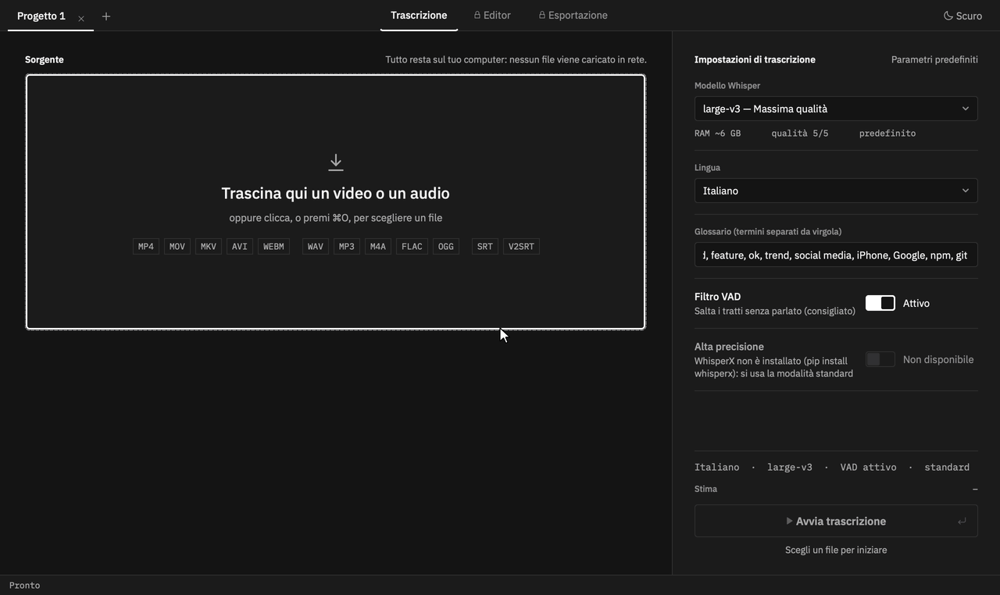

# Video → SRT

Desktop app that transcribes **Italian** video and audio into `.srt` subtitles ready for
editing, with a built-in editor to review them line by line. Everything runs **on your
computer**: no file is uploaded anywhere and, after the first setup, the app works offline.



<sub>Demo recorded with a synthetic voice; the transcription progress is sped up, everything else is the real app. The interface is in Italian.</sub>

**Platforms:** macOS Apple Silicon · macOS Intel · Windows — see [Installation](#installation) and [`packaging/`](packaging/README.md).

---

## Features

**Transcription**
- Whisper `large-v3` through [faster-whisper](https://github.com/SYSTRAN/faster-whisper), with word-level timestamps
- Noise reduction and a voice activity filter (VAD) that skips silence, so fewer invented sentences; speech the filter skipped by mistake is recovered
- **Glossary** for English terms, brands and names (`iPhone`, `deploy`, `social media`…) without losing Italian punctuation
- Subtitles laid out with professional readability rules: 42 characters per line, 2 lines, 17 characters per second, 0.83–7 s on screen, and line breaks that never leave an article or preposition at the end of a line

**Editor**
- Editable table and an Inspector with millisecond timing; unlimited undo/redo
- Split, merge, delete, find and replace
- Live checks: overlaps, subtitles that are too fast, too short or too long
- Video preview with subtitles on top, and an interactive waveform: click to seek, scroll wheel or two fingers to pan, ⌘ + wheel or pinch to zoom
- Editor-style shortcuts (Space, J/K/L, arrows); everything is keyboard-reachable with a visible focus ring

**Export**
- SRT, WebVTT, TXT, ASS and the `.v2srt` project format (reopen and keep editing)
- One-click copy for YouTube Studio, Vimeo, Premiere Pro / DaVinci Resolve

**Also**
- Several projects open in tabs, light and dark theme, autosave
- **Parameter profiles** (`.vsrtconfig`): *File → Import / Export configuration* to save and share glossary, prompt, VAD and readability limits
- macOS (Apple Silicon and Intel) and Windows

---

## How it works

```
video / audio file
   │  FFmpeg: 16 kHz audio + noise reduction
   ▼
Silero VAD ──► speech regions
   │
   ▼
faster-whisper large-v3 (Italian, beam search, prompt + glossary)
   │  words with timing and confidence
   ▼
recover skipped speech ──► subtitle layout (lines, duration, reading speed)
   │
   ▼
editor ──► export SRT / VTT / TXT / ASS
```

| Component | Technology |
|---|---|
| Speech recognition | faster-whisper (CTranslate2), Whisper `large-v3` model |
| Voice activity detection | Silero VAD |
| Audio and video | FFmpeg, Qt Multimedia |
| Interface | PySide6 (Qt 6) |
| Packaging | PyInstaller (`.app` / `.dmg`, `.exe`) |

---

## Requirements

- **8 GB of RAM** (`large-v3` uses about 6 GB; lighter models are available)
- **4–10 GB of disk space** for the model and dependencies
- **FFmpeg** (installed by the setup scripts)
- **Python 3.10+** for development (3.11 recommended; the code stays 3.9-compatible)
- Internet **only** on first launch, to download dependencies and the model

| Model | RAM | Italian quality | Use it for |
|---|---|---|---|
| `tiny` · `base` | ~1 GB | ★☆☆☆☆ · ★★☆☆☆ | Quick tests |
| `small` | ~2 GB | ★★★☆☆ | Low-memory machines |
| `medium` | ~5 GB | ★★★★☆ | A good alternative |
| **`large-v3`** | **~6 GB** | **★★★★★** | **Default** |
| `large-v3-turbo` | ~4 GB | ★★★★½ | Faster, nearly the same quality |

**Input formats:** MP4, MOV, MKV, AVI, WebM, M4V · MP3, WAV, M4A, FLAC, OGG, AAC, WMA · SRT and `.v2srt` to reopen a job.

---

## Installation

| Platform | Setup and run | Build the app |
|---|---|---|
| **macOS · Apple Silicon** | `packaging/macos/install.sh --run` | `bash packaging/macos/apple-silicon/build.sh` → `.app` + `.dmg` |
| **macOS · Intel** | `packaging/macos/install.sh --run` | `bash packaging/macos/intel/build.sh` → `.app` + `.dmg` |
| **Windows 10/11** | `packaging\windows\setup_windows.bat --run` | `python packaging\windows\build_windows.py` → `.exe` |

The setup scripts install FFmpeg, create the Python environment, install dependencies and
download the model. Details and troubleshooting: [macOS](packaging/macos/README.md) ·
[Windows](packaging/windows/README.md).

**Manual setup**, from the repository root:

```bash
python -m venv .venv
source .venv/bin/activate          # Windows: .venv\Scripts\activate
pip install -r app/requirements.txt -r requirements-dev.txt
python app/main.py
```

FFmpeg must be on `PATH` (macOS: `brew install ffmpeg`). The model downloads on first use.

---

## Keyboard shortcuts

⌘ on macOS, Ctrl on Windows and Linux.

| Keys | Action |
|---|---|
| ⌘O · ⌘N | Open file · new transcription |
| Space · J / K / L | Play/pause · back 2 s / pause / play |
| ← / → · ⇧← / ⇧→ | ±1 s · previous / next subtitle |
| ⌘K · ⌘M · ⌘⇧K | Split · merge with next · delete |
| ⌘Z · ⌘⇧Z | Undo · redo |
| ⌘F · ⌘⌥F | Search · find and replace |
| ⌘I | Show/hide the Inspector |
| ⌘S · ⌘⇧S · ⌘E | Export SRT · save project · Export tab |
| ⌘⇧T · ⌘W · ⌃Tab | New tab · close tab · next tab |
| ⌘⇧L | Light/dark theme |

The full list, with edge cases, is in [`CLAUDE.md`](CLAUDE.md).

---

## Development

```
app/                      the application (one codebase for every platform)
├── main.py               entry point
├── engine.py             transcription pipeline
├── platform_support.py   everything OS-specific
├── core/                 subtitle model, layout, I/O, configuration, player
├── ui/                   PySide6 interface
└── tests/                pytest suite (offscreen UI)
packaging/
├── macos/
│   ├── apple-silicon/    Apple Silicon build
│   └── intel/            Intel build
└── windows/              Windows setup and build
docs/                     specs, plans, design references, README media
```

```bash
QT_QPA_PLATFORM=offscreen python -m pytest -q    # Windows (cmd): set QT_QPA_PLATFORM=offscreen
ruff check app
```

GitHub Actions runs lint and tests on macOS, Windows and Linux. Architecture rules (in Italian)
are in [`CLAUDE.md`](CLAUDE.md).

---

## License

**MIT**: you may use, modify, redistribute and sell the software, including in proprietary
products, as long as you keep the copyright notice. Full text in [LICENSE](LICENSE). The
software comes with no warranty.

### Third-party components

| Component | License |
|---|---|
| [PySide6 / Qt](https://www.qt.io/qt-for-python) | LGPLv3 (or commercial) |
| [faster-whisper](https://github.com/SYSTRAN/faster-whisper) / CTranslate2 | MIT |
| [Whisper](https://github.com/openai/whisper) (model) | MIT |
| [Silero VAD](https://github.com/snakers4/silero-vad) | MIT |
| [ONNX Runtime](https://github.com/microsoft/onnxruntime) | MIT |
| [NumPy](https://numpy.org/) · [soundfile](https://github.com/bastibe/python-soundfile) | BSD-3-Clause |
| [IBM Plex](https://github.com/IBM/plex) (fonts) | SIL Open Font License 1.1 |
| [FFmpeg](https://ffmpeg.org/) | LGPLv2.1+ / GPLv2+ depending on the build |
| [PyInstaller](https://pyinstaller.org/) | GPLv2+ with a bootloader exception |

FFmpeg runs as a separate process and is not linked into the program, so its license does not
extend to this project's code, which stays MIT.

**If you redistribute the binaries** (`.app` / `.dmg` / `.exe`), the package contains copyleft
components:

- **Qt/PySide6** — LGPLv3 requires that users can replace the Qt libraries with their own
  version; publishing the full source and build scripts, as this repository does, supports that.
- **FFmpeg** — builds configured with `--enable-gpl` are GPL. If you ship a package that
  includes an FFmpeg binary, you must also provide its source code or a written offer for it
  (GPL section 6). The source is at [ffmpeg.org](https://ffmpeg.org/download.html).

The setup scripts install FFmpeg through the system package manager (Homebrew on macOS); in that
case this project does not redistribute the binary and the obligation does not apply.
